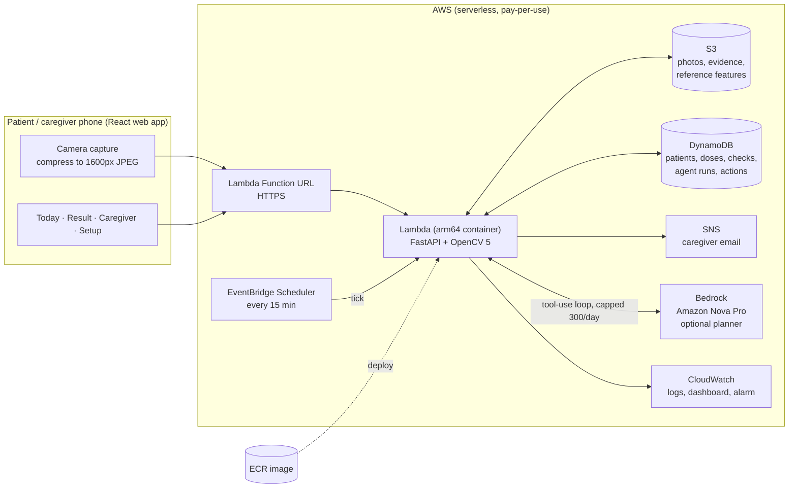
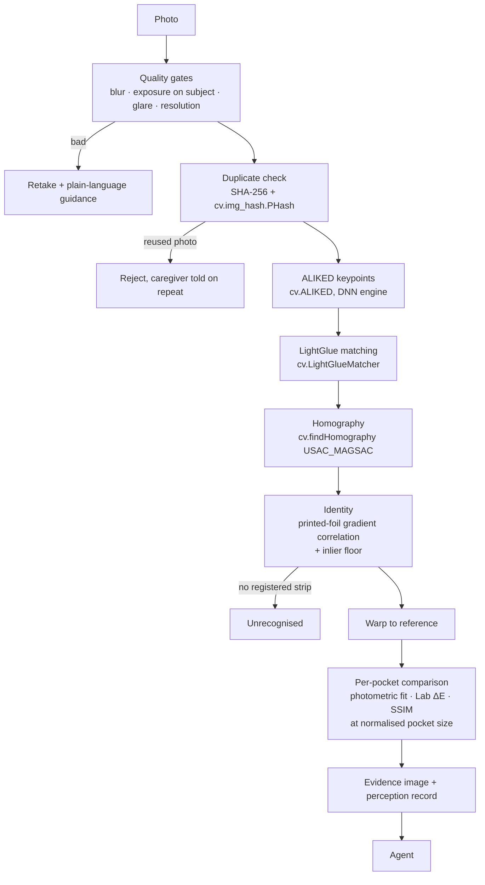
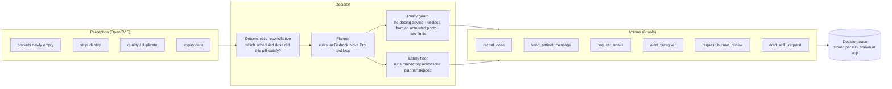

# PillCheck — Technical Report

**OpenCV AI Competition 2026 (powered by AWS) · Solo entry by Ishaan Gupta (IIIT Delhi)**

PillCheck checks that an elderly patient actually took their medicine. After each dose the patient photographs their blister strip. OpenCV 5 aligns the photo to a reference photo of the full strip, decides pocket by pocket which tablets are gone, and an agent turns that evidence into actions: record the dose, remind, ask for a retake, alert the caregiver, or ask a human to decide.

---

## 1. Problem and users

- In India most tablets come in blister strips, and many elderly patients live apart from the family members who worry about their medicines. Missed doses, double doses and the wrong strip are common and invisible to the caregiver.
- Existing reminder apps rely on the patient tapping "taken". That proves nothing and is easy to forget or tap by mistake.
- **Patient:** elderly, possibly low tech-confidence; needs one big button, Hindi or English, no typing.
- **Caregiver:** a son or daughter elsewhere; wants to be told *only* when something needs attention, with evidence.

## 2. Architecture



**Inside the Lambda, per photo:**



Infrastructure is one CloudFormation template (`backend/infra/template.yaml`, cfn-lint clean) deployed by `backend/infra/deploy.sh`, which prints the resources and cost estimate and asks for confirmation (and separately for Bedrock) before creating anything. `teardown.sh` removes everything.

## 3. OpenCV 5 implementation

| Step | OpenCV 5 API | Why |
|---|---|---|
| Keypoints | `cv.ALIKED` (ONNX on the new DNN engine) | Learned features survive foil glare and crumpling far better than corner detectors |
| Matching | `cv.LightGlueMatcher` (`setPairInfo` + `match`) | Context-aware matching; hundreds of inliers on the same strip, ≤10 on a different one |
| Geometry | `cv.findHomography(..., cv.USAC_MAGSAC)` | Robust to the many wrong matches a reflective strip produces |
| Strip outline | `cv.grabCut` seeded by the pockets | Keeps the table out of the lighting correction |
| Pocket finding (setup) | `cv.HoughCircles(HOUGH_GRADIENT_ALT)`, Canny contours, `cv.fitEllipse`, CLAHE | Proposes pockets; caregiver can mark empty / add / remove |
| Pocket state | Lab colour distance + SSIM after a photometric fit, compared at a fixed ~64 px pocket size | Detects a popped pocket even on opaque silver (Alu-Alu) strips |
| Re-used photos | `cv.img_hash.PHash` | Stops someone resending yesterday's photo |
| Expiry date | `cv.dnn.TextDetectionModel_DB` (PP-OCRv3) + `cv.dnn.TextRecognitionModel` (CRNN), variable-width input | Reads "EXP 12/2027" at setup; caregiver confirms |

**Bug found in OpenCV 5.0.0:** `LightGlueMatcher.match` kills the whole process with SIGFPE when a pair produces zero matches (two unrelated strips). PillCheck appends four identical anchor points to both sides and discards them afterwards, so the server never crashes on a wrong strip.

## 4. The agent (Agentic Vision)



- **Facts are computed, not generated.** Which dose a pill belongs to, what is overdue and how many tablets are left are computed in code; the planner only chooses actions.
- **Human control:** refills wait for caregiver approval; unclear pockets after one retake go to the caregiver as a review question; the caregiver confirms pockets and expiry at setup.
- **Observability:** every run stores perception, plan, policy decisions and results; the caregiver's "Why the agent acted" screen shows it.

**Trace example (OpenCV output changes the action):** at 9:40 the photo shows pockets 2 and 3 newly empty while only the 9:00 dose (already recorded) was due → reconciliation finds 2 extra tablets → `record_dose` records them as extra → `alert_caregiver(severity=urgent, reason=extra_removed)` "possible double dose" → `send_patient_message` tells the patient the caregiver was informed. The same photo with *one* pocket at 9:10 instead produces `record_dose` + a confirmation message and no alert.

## 5. Evaluation

### 5.1 Real photos (main result)

Data: 329 real phone photos (≥480 px) of mostly Indian strips from the public MedCheck dataset (github.com/MahiiBamba/mini_project_medcheck), every pocket labelled intact/broken. Online photos are single shots, so each test pair is built as: **setup photo** = the real photo, with already-broken pockets marked empty; **later photo** = the same real photo re-shot with a random camera change (angle, rotation, scale, light, white balance, blur, noise, JPEG, sometimes a reflection) and 0–2 intact pockets replaced by a real broken pocket cut from the same strip. Script: `backend/eval/run_real_web.py` (seed 2026).

| Taken / not taken (211 photos) | Result |
|---|---|
| Correct | **163 (77.3%)** |
| Asked for a retake (nothing recorded) | 41 (19.4%) |
| Wrong | 7 (3.3%) |
| **Accuracy when it answers** | **95.9%** |
| Taken pills found | 107 / 122 |
| Median time per check | 2.3 s |

| Pocket finding at setup | Recall | Precision |
|---|---|---|
| Mostly full strips (114 photos, 1,338 pockets) | 72% | 97% |
| All photos (329) | 63% | 96% |

Identity on real strips: the same strip gives 199–860 LightGlue inliers after a camera change; different real strips gave ≤10 inliers and 0 of 80 aligned.

### 5.2 Synthetic benchmark (controlled conditions)

Rendered strips under 5 difficulty conditions (`backend/eval/run_eval.py`): registration 98.7%, pocket accuracy 100%, abstention 2.1%; identity: right strip 148/150, wrong registered strip named 25/25, unregistered rejected 5/5. Baseline: classic ORB matching scores the same on synthetic data and is ~4× faster; on real photos ALIKED + LightGlue is used.

### 5.3 What real photos changed

The first real run exposed problems the synthetic set hid, each fixed and re-measured: missed doses on silver foil (pockets now compared at a fixed size → 37/37 taken pills found on the tuning set), the OpenCV SIGFPE crash, photos on black cloth rejected as "too dark" (exposure now judged on the subject), and real strips not recognised (identity now also uses the inlier count).

### 5.4 Failure cases and limitations

- **Opaque silver (Alu-Alu) strips** cause most errors: a full and an empty pocket differ only by crumpled foil. 6 photos recorded a pill that wasn't taken; 9 pills were missed.
- The taken-pocket test uses real broken pockets **transplanted** within the same strip, not a second real photo of the same strip; real before/after pairs are the next step.
- Automatic pocket finding misses ~28% of pockets on real strips, so setup lets the caregiver add, remove and mark pockets.
- **Expiry reading is weak on real foil print** (roughly 1 in 4 dates read automatically on a small semi-real sample). It is a helper: the caregiver always confirms, and an unread date is asked for, never assumed.
- Strips must be photographed from the same side as at setup.

## 6. Responsible use

- PillCheck supports adherence; it **never gives medical or dosing advice**. A policy filter blocks patient messages that read as dosing instructions.
- A photo it is unsure about never becomes a dose record: it asks for a retake, then asks the caregiver.
- Photos are health-adjacent data: stored in a private, encrypted S3 bucket that expires objects after 90 days; demo sessions never send real messages.
- Spending guards: per-visitor rate limits, a daily cap on photo checks and on Bedrock calls, and confirm-before-create deployment.

## 7. Build, test, deploy

```bash
# backend
cd backend && python3 -m venv .venv && source .venv/bin/activate
pip install -r requirements.txt -r requirements-dev.txt
python scripts/download_models.py          # ALIKED, LightGlue, PP-OCRv3, CRNN (checksummed)
pytest -q                                  # 31 tests
# frontend
cd ../frontend && npm ci && npm run build
# run (serves the app on http://localhost:8000)
cd ../backend && uvicorn pillcheck.api.main:app --port 8000
# evaluations
python eval/run_eval.py                    # synthetic
python eval/run_real_web.py --data <MedCheck_Combined>   # real photos
# AWS (asks before creating anything)
./infra/deploy.sh    # ./infra/teardown.sh to remove
```

Dependencies are pinned in `backend/requirements*.txt` (opencv-contrib-python-headless==5.0.0.93) and `frontend/package-lock.json`.
